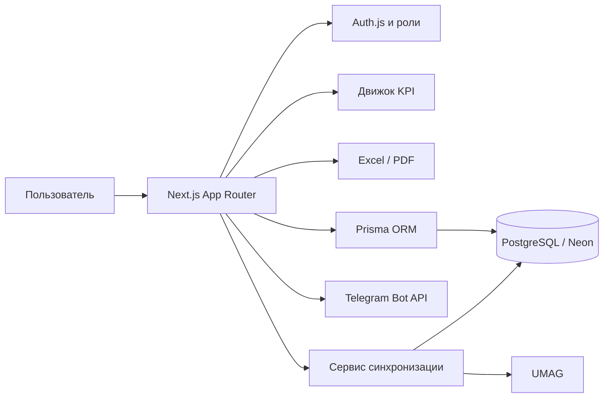

<div align="center">
  # KPI Service — Public Demo

  **Веб-сервис для управления планами продаж, KPI сотрудников и операционными показателями команды.**

  [](https://nextjs.org/)
  [](https://react.dev/)
  [](https://www.typescriptlang.org/)
  [](https://www.prisma.io/)
  [](https://neon.tech/)

  [Возможности](#возможности) · [Локальный запуск](#локальный-запуск) · [Деплой](#деплой-на-vercel)
</div>

---

## О проекте

KPI Service объединяет в одном интерфейсе выручку, планы отделов, личные результаты сотрудников, дисциплину, качество обслуживания и дополнительные KPI. Руководитель видит отклонения за выбранный период, а сотрудник получает понятную расшифровку итоговой оценки.

Это публичная демонстрационная копия. В ней используются только синтетические сотрудники, планы и учётные данные, задаваемые через переменные окружения.

Сервис поддерживает несколько отделов, разграничивает доступ по ролям, хранит историю изменений и экспортирует отчёты в Excel и PDF.

## Возможности

| Раздел | Что доступно |
| --- | --- |
| **Дашборд** | Выручка, средний чек, количество клиентов, прогноз месяца, динамика и сравнение отделов |
| **Сотрудники** | Профили, личные планы, итоговый KPI и подробная расшифровка показателей |
| **Журналы контроля** | Продажи, допродажи, дисциплина, отзывы, жалобы и качество обслуживания |
| **Планы продаж** | Ежемесячные цели сотрудников и отделов, выходные дни и прогресс выполнения |
| **Настройки KPI** | Базовые веса и дополнительные ежедневные показатели по выбранным отделам |
| **Доступы** | Роли пользователей, привязка РОП к отделам и ограничения редактирования |
| **Отчёты** | Экспорт дашборда, сотрудников, профилей и журналов в Excel или PDF |
| **Интеграции** | Синхронизация продаж через внешний UMAG-бот и уведомления о жалобах в Telegram |

## Модель KPI

Базовая конфигурация даёт итоговую оценку от 0 до 100%.

| Компонент | Вес по умолчанию |
| --- | ---: |
| Базовая часть | 35% |
| Дисциплина | 15% |
| Личный результат | 30% |
| Допродажи | 10% |
| Качество | 10% |

Администратор может добавлять ежедневные показатели. Их вес выделяется из доли личного результата, поэтому общий KPI остаётся в диапазоне 0–100%.

## Роли и права

| Роль | Доступ |
| --- | --- |
| `ADMIN` | Все разделы, управление доступами, настройки KPI, сотрудники и планы |
| `MANAGER` | Рабочие разделы и данные всех отделов без административных настроек |
| `ROP` | Сотрудники, журналы и показатели только закреплённых отделов |

Сессии работают через Auth.js с JWT. Пароли хранятся в виде bcrypt-хешей. Изменения записей журналов сохраняются в аудите вместе с автором, временем и снимками изменённых полей.

## Технологии

- **Next.js 16.4** — App Router, Server Components и Server Actions;
- **React 19 + TypeScript 5** — интерфейс и типизация;
- **Tailwind CSS 4** — стили и адаптивная компоновка;
- **Prisma 7 + PostgreSQL** — схема, миграции и доступ к данным;
- **Neon serverless adapter** — подключение к PostgreSQL;
- **Auth.js 5** — вход по email и паролю, JWT-сессии и роли;
- **Recharts** — графики динамики;
- **ExcelJS** — формирование Excel-отчётов.

## Архитектура



Интеграция с UMAG реализована отдельным сервисом `umag_sales_report_bot`. Кнопка синхронизации в приложении вызывает его защищённый HTTP endpoint, после чего данные появляются в общей PostgreSQL-базе.

## Локальный запуск

### Требования

- Node.js 20.9 или новее;
- npm;
- PostgreSQL или база [Neon](https://neon.tech/).

### 1. Установите зависимости

```bash
npm ci
```

### 2. Создайте файл окружения

```powershell
Copy-Item .env.example .env
```

Для macOS или Linux:

```bash
cp .env.example .env
```

Заполните как минимум `DATABASE_URL` и `AUTH_SECRET`.

### 3. Подготовьте базу

```bash
npx prisma generate
npx prisma migrate dev
npx prisma db seed
```

Seed создаёт синтетических сотрудников, демонстрационные планы и администратора из переменных `SEED_ADMIN_EMAIL` и `SEED_ADMIN_PASSWORD`. Пароль должен содержать не менее 12 символов и не хранится в репозитории.

### 4. Запустите приложение

```bash
npm run dev
```

Откройте [http://localhost:3000](http://localhost:3000). Неавторизованный пользователь будет перенаправлен на `/login`.

## Переменные окружения

| Переменная | Обязательна | Назначение |
| --- | :---: | --- |
| `DATABASE_URL` | Да | Строка подключения PostgreSQL/Neon |
| `AUTH_SECRET` | Да | Секрет подписи Auth.js |
| `SEED_ADMIN_EMAIL` | Для seed | Email администратора демонстрационной базы |
| `SEED_ADMIN_PASSWORD` | Для seed | Уникальный пароль администратора длиной от 12 символов |
| `BOT_SYNC_URL` | Нет | URL защищённого endpoint внешнего сервиса синхронизации |
| `BOT_SYNC_SECRET` | Нет | Секрет заголовка `X-Sync-Secret` |
| `TELEGRAM_BOT_TOKEN` | Нет | Токен Telegram-бота для уведомлений о жалобах |
| `TELEGRAM_ALERT_CHAT_IDS` | Нет | ID чатов через запятую |

Сгенерировать `AUTH_SECRET` можно командой:

```bash
npx auth secret
```

## Команды

| Команда | Назначение |
| --- | --- |
| `npm run dev` | Запуск среды разработки |
| `npm run build` | Генерация Prisma Client и production-сборка |
| `npm run start` | Запуск собранного приложения |
| `npm run lint` | Проверка ESLint |
| `npx prisma migrate dev` | Создание и применение миграций локально |
| `npx prisma migrate deploy` | Применение готовых миграций на сервере |
| `npx prisma db seed` | Начальное заполнение базы |

Проверки бизнес-логики и экспорта:

```bash
npx tsx scripts/check-daily-target.ts
npx tsx scripts/check-custom-kpi.ts
npx tsx scripts/check-export.ts
```

## Структура проекта

```text
src/
├── app/
│   ├── (app)/
│   │   ├── dashboard/    # сводные показатели и экспорт
│   │   ├── employees/    # сотрудники и личные профили
│   │   ├── logs/         # журналы контроля
│   │   ├── plans/        # планы продаж и выходные
│   │   ├── settings/     # веса и дополнительные KPI
│   │   └── access/       # пользователи и роли
│   └── login/            # авторизация
├── components/           # общие компоненты интерфейса
├── lib/
│   ├── auth.ts           # конфигурация Auth.js
│   ├── kpi.ts            # основной расчёт KPI
│   ├── custom-kpi.ts     # дополнительные показатели
│   ├── export-xlsx.ts    # Excel/PDF-экспорт
│   ├── prisma.ts         # Prisma Client + Neon adapter
│   └── telegram.ts       # уведомления о жалобах
└── generated/prisma/     # генерируемый Prisma Client

prisma/
├── schema.prisma         # модели базы данных
├── migrations/           # история миграций
└── seed.ts               # начальные данные
```

## Деплой на Vercel

1. Создайте PostgreSQL-базу в Neon.
2. Импортируйте репозиторий в Vercel.
3. Добавьте `DATABASE_URL` и `AUTH_SECRET` в настройках проекта.
4. При необходимости добавьте переменные синхронизации и Telegram.
5. Примените миграции к production-базе:

   ```bash
   npx prisma migrate deploy
   ```

6. Выполните deployment через Git-интеграцию или CLI:

   ```bash
   vercel --prod
   ```

`npm run build` уже запускает `prisma generate` перед сборкой Next.js.

## Важные правила данных

<details>
<summary><strong>Дополнительные ежедневные KPI</strong></summary>

- Показатель действует только в заданном диапазоне дат и выбранных отделах.
- Пустой факт считается нулём.
- Перевыполнение одного дня не компенсирует недобор другого дня.
- Выходные сотрудника и дата найма исключаются из расчётного периода.
- Суммарный вес дополнительных метрик отдела не может превышать вес личного результата.

</details>

<details>
<summary><strong>Продажи и долговые накладные</strong></summary>

- Неоплаченная или частично оплаченная накладная входит в продажи полной суммой.
- Остаток долга хранится отдельно и повторно не прибавляется к выручке.
- Повторная синхронизация обновляет существующую запись, не создавая дубль.
- Исторические изменения требуют повторной синхронизации нужного диапазона дат во внешнем сервисе.

</details>

## Текущие ограничения

- Восстановление и самостоятельная смена пароля пока не реализованы.
- Интеграция с UMAG зависит от отдельно развёрнутого сервиса синхронизации.
- CSV-экспорт отсутствует; доступны Excel и PDF.

---

<div align="center">
  <sub>KPI Service · публичная демонстрационная версия</sub>
</div>
